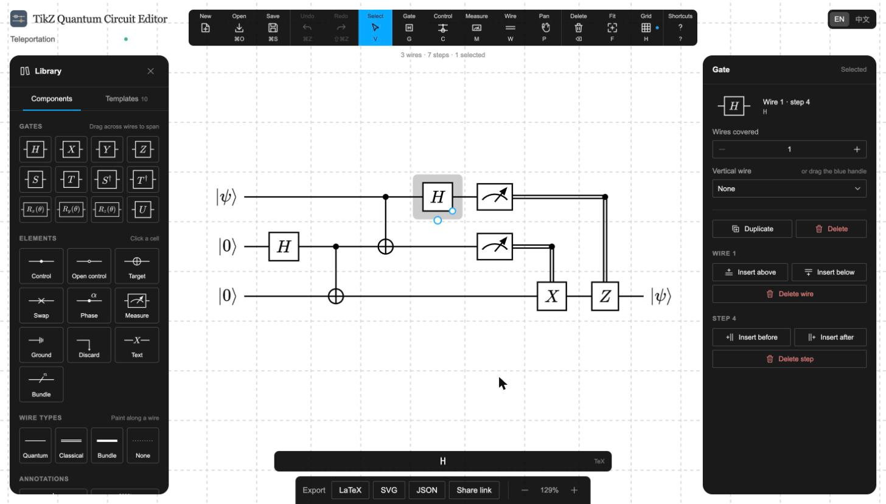

# TikZ Quantum Circuit Editor

A visual editor for quantum circuits, with export to LaTeX (quantikz2), SVG or a share link. This project is inspired by [Quantikz-and-QuerasAWS](https://github.com/Quantum-Software-Development/Quantikz-and-QuerasAWS) and aims to rebuild it with [quiver](https://q.uiver.app/) style UI.



## How to Use

Use the [online editor](https://haixuan-lin.github.io/tikz-quantum-circuit-editor/) in your browser. The exported LaTeX needs, in the preamble:

```latex
\usepackage{tikz}
\usetikzlibrary{quantikz2}
```

Existing `quantikz` code can be pasted into **Open** to keep editing it.

On macOS (Apple Silicon), compile the repository into an application in this directory by running:

```bash
./build.sh
```

The script detects missing build tools and dependencies automatically. After a successful build, install the app into `/Applications/` by running:

```bash
./install.sh
```

To use the browser version during development, run:

```bash
npm ci
npm run dev
```

Open `http://127.0.0.1:8001` in a browser. Web development requires `Node.js ≥ 22.12` and `npm`. Command `npm test` runs the tests; `npm run dist` produces a standalone web app.
